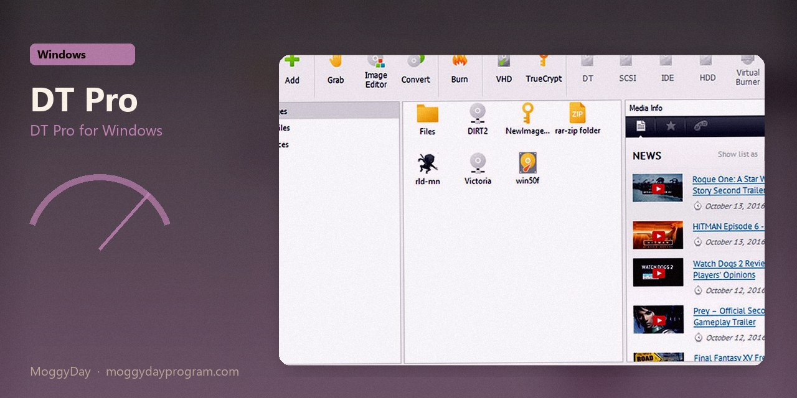
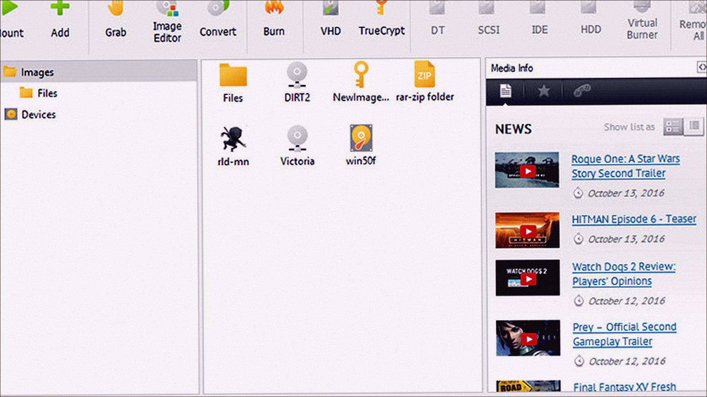
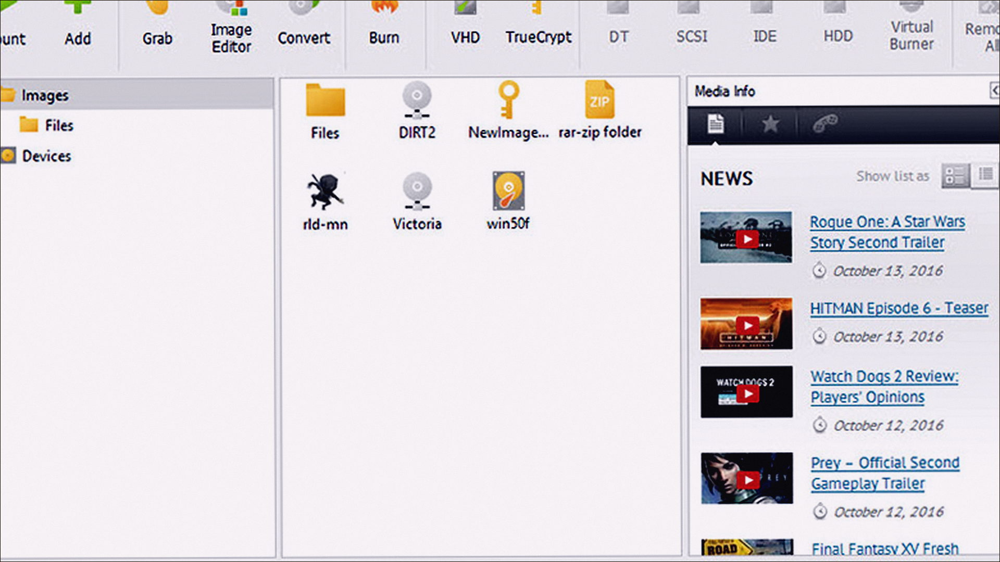
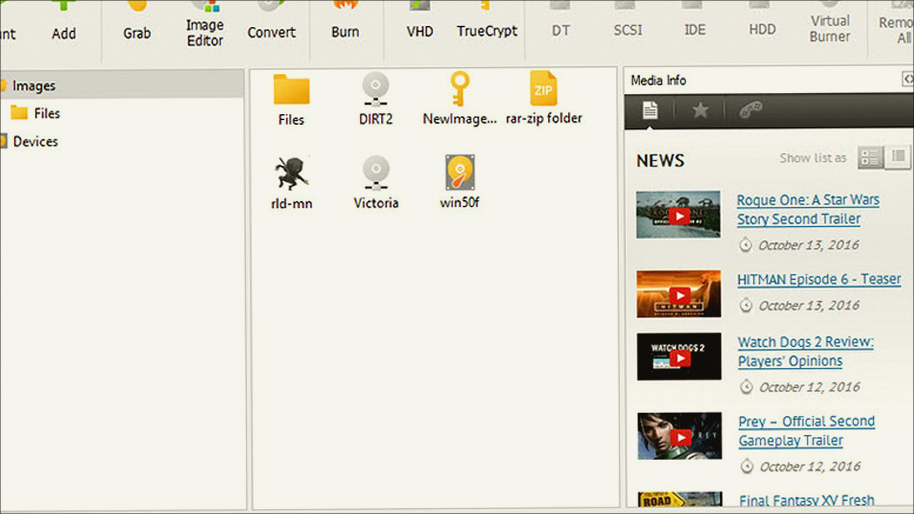

# DAEMON Tools Pro 8.3.1

DT Pro for Windows. DAEMON Tools Pro on Windows 10/11 x64. 32 MB. Requirements, screenshots, MoggyDay Launcher.

[Pages](https://laserbetweenmap.github.io/daemon-tools-pro-windows/) · [RU](https://moggydayprogram.com/programs/daemon-tools-pro) · [EN](https://moggydayprogram.com/en/programs/daemon-tools-pro)

  

  
  
  

1. Open the RU or EN card on moggydayprogram.com
2. Use the main button, or the launcher for large archives

Category: [System catalog](https://moggydayprogram.com/categories/system)

- [DAEMON Tools Ultra](https://moggydayprogram.com/programs/daemon-tools-ultra)
- [PowerISO](https://moggydayprogram.com/programs/poweriso)
- [UltraISO](https://moggydayprogram.com/programs/ultraiso)

No installer in this git repo.
